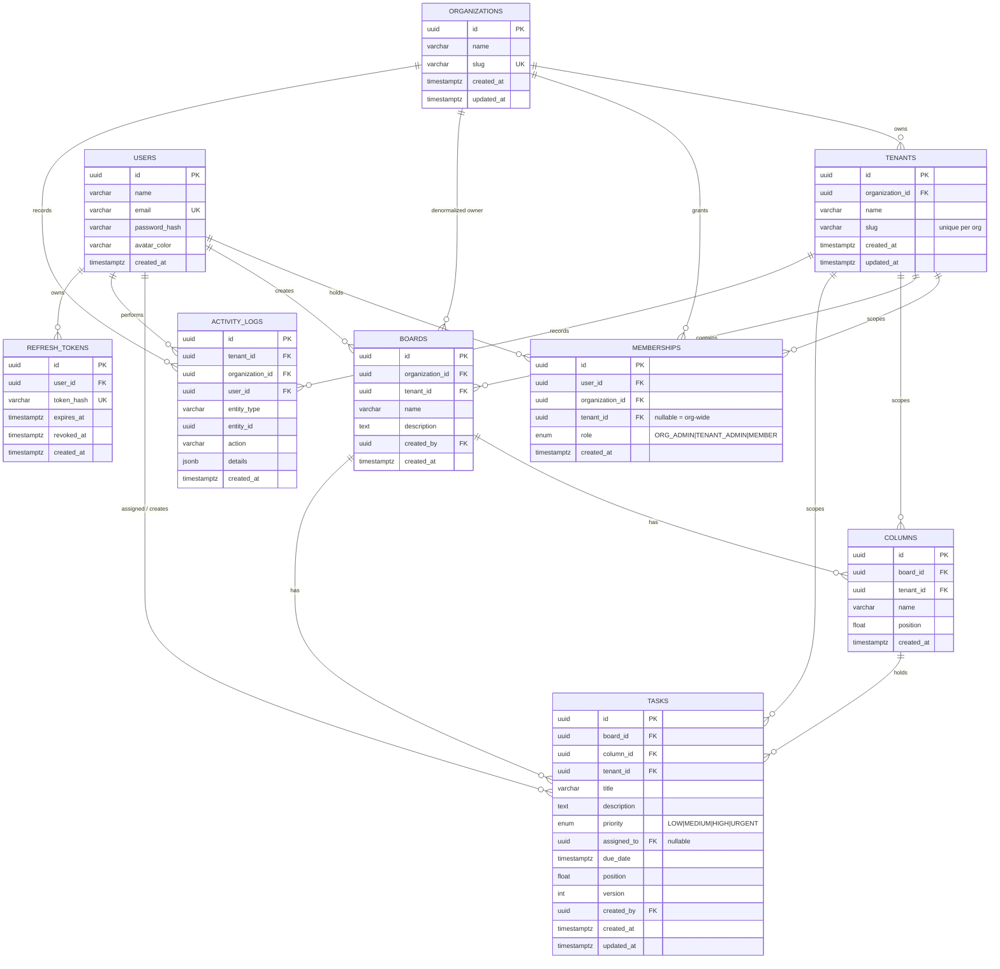

# Database design & ERD

> Diagram: [`database-erd.svg`](./database-erd.svg) · DDL: [`../database/schema.sql`](../database/schema.sql) · Prisma: [`../backend/prisma/schema.prisma`](../backend/prisma/schema.prisma)

JulleyOnline is a **shared-database, shared-schema multi-tenant** application.
One PostgreSQL database holds every organization; isolation is enforced by an
explicit `tenant_id` on every tenant-owned row and by the API layer, which
resolves the active tenant from the caller's memberships before touching data.

## Hierarchy

```
Organization (company)
└── Tenant (branch / office)      ← the isolation boundary
    └── Board
        └── Column
            └── Task
```

Users are global (one account can belong to several organizations). A
`Membership` row grants a role either organization-wide (`tenant_id IS NULL`,
always `ORG_ADMIN`) or inside one tenant (`TENANT_ADMIN` / `MEMBER`).

## Diagram



## Table dictionary

### `organizations`

| Column | Type | Notes |
| --- | --- | --- |
| `id` | uuid | PK |
| `name` | varchar(120) | Display name |
| `slug` | varchar(80) | Globally unique, generated from the name |
| `created_at`, `updated_at` | timestamptz | Audit timestamps |

Creating an organization also creates the owner's `ORG_ADMIN` membership, a
`Head Office` tenant, a starter board and four default columns — all in one
transaction.

### `tenants`

| Column | Type | Notes |
| --- | --- | --- |
| `id` | uuid | PK — the value sent as `X-Tenant-Id` |
| `organization_id` | uuid | FK → `organizations.id`, cascade delete |
| `name` | varchar(120) | e.g. `Hyderabad HQ` |
| `slug` | varchar(80) | Unique **within** the organization (`@@unique([organizationId, slug])`) |

### `users`

Global identity. `email` is unique; `password_hash` is bcrypt (cost 12). There
is deliberately no `tenant_id` here — the same person can work in several
organizations.

### `memberships`

| Column | Type | Notes |
| --- | --- | --- |
| `user_id` | uuid | FK → `users.id` |
| `organization_id` | uuid | FK → `organizations.id` |
| `tenant_id` | uuid, nullable | `NULL` = organization-wide grant |
| `role` | enum | `ORG_ADMIN`, `TENANT_ADMIN`, `MEMBER` |

`UNIQUE(user_id, tenant_id)` prevents duplicate tenant grants. The tenant
middleware resolves the *effective* role: a tenant-specific membership wins;
otherwise an org-wide `ORG_ADMIN` row grants access to every tenant in that
organization.

### `boards`

| Column | Type | Notes |
| --- | --- | --- |
| `organization_id` | uuid | Denormalized for org-level counts |
| `tenant_id` | uuid | **Isolation key** |
| `name`, `description` | varchar / text | |
| `created_by` | uuid | FK → `users.id`, restrict delete |

Indexes: `(tenant_id)`, `(organization_id)`, `(tenant_id, created_at)`.

### `columns`

| Column | Type | Notes |
| --- | --- | --- |
| `board_id` | uuid | FK → `boards.id`, cascade |
| `tenant_id` | uuid | Isolation key (also lets the API verify a column belongs to the tenant) |
| `name` | varchar(80) | e.g. `In Progress` |
| `position` | float | Fractional order, gap `1024` |

Index: `(board_id, position)` makes ordered board loads cheap.

### `tasks`

| Column | Type | Notes |
| --- | --- | --- |
| `board_id`, `column_id`, `tenant_id` | uuid | FKs; every lookup filters by `tenant_id` |
| `title`, `description` | varchar(200) / text | |
| `priority` | enum | Defaults to `MEDIUM` |
| `assigned_to` | uuid, nullable | FK → `users.id`, `ON DELETE SET NULL`; must be a member of the tenant |
| `due_date` | timestamptz, nullable | |
| `position` | float | Ordering **within a column** |
| `version` | int | Optimistic-lock counter, incremented on every write |
| `created_by` | uuid | Members may only delete tasks they created |

Indexes: `(tenant_id)`, `(tenant_id, board_id)`, `(tenant_id, column_id, position)`,
`(assigned_to)`, `(due_date)`.

**Ordering.** A move computes the midpoint between the neighbours'
`position` values. When the gap becomes smaller than the safety threshold the
whole destination column is re-spaced to `(i + 1) * 1024` inside the same
transaction. This keeps drag-and-drop O(1) for the common case and never
requires shifting every task on each move.

**Concurrency.** Clients send the `version` they loaded. Updates and moves use
`UPDATE … WHERE id = ? AND tenant_id = ? AND version = ?`; zero rows updated
means someone else won, and the API returns `409 CONFLICT` with the current
task so the UI can show a merge dialog.

### `activity_logs`

Append-only audit trail. `details` is JSONB so each action can store a
different shape (`{ from, to }`, `{ title, changes }`, `{ memberEmail }`, …).
Actions: `CREATED`, `UPDATED`, `MOVED`, `DELETED`, `MEMBER_ADDED`,
`MEMBER_UPDATED`, `MEMBER_REMOVED`. Indexed by `(tenant_id, created_at)` for
the feed and `(entity_type, entity_id)` for per-task history.

### `refresh_tokens`

Opaque refresh tokens are stored **hashed** (SHA-256), never raw. Rotation
revokes the old row; presenting an already-revoked token is treated as theft
and revokes every active session for that user.

## Tenant-isolation invariants

1. Every tenant-owned table has a non-null `tenant_id`.
2. Every read and write includes `tenant_id` in the `WHERE` clause — there is
   no "find by id only" path in the services.
3. `X-Tenant-Id` is validated against `memberships` on every request; a forged
   header yields `403`.
4. Foreign keys are also checked for tenant membership (e.g. a task's column
   must belong to the same board *and* tenant).
5. WebSocket rooms are joined server-side after the same membership check.
6. The AI service receives a pre-filtered snapshot and has no database access.

## Why these choices

- **`tenant_id` on children instead of joins through `boards`.** A task query
  becomes `WHERE tenant_id = ? AND column_id = ?` using one composite index,
  and a bug that forgets a join cannot widen the result set.
- **Float positions.** Cheap inserts/moves; rebalancing is rare and local to
  one column. An integer `position` would require updating every following row
  on each drag.
- **Version column.** Avoids lost updates without table-level locks and gives
  the client enough information to offer a real conflict choice.
- **JSONB activity details.** One table serves many event shapes while staying
  queryable (`details->>'from'`).
- **No soft deletes.** The brief asks for a live Kanban; deletions are audited
  in `activity_logs` so history survives the row.
